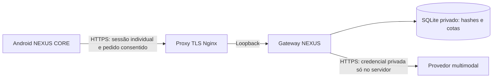

# Implantar o NEXUS AI online — piloto controlado

Continuação do mesmo aplicativo NEXUS 4.1. Este documento entrega a configuração do serviço e não afirma que um servidor, domínio, conta de provedor ou certificado já foram criados. **Não houve implantação desta configuração em produção neste ambiente.** A disponibilidade e a qualidade do modelo só podem ser confirmadas com uma chamada real autorizada e as avaliações de escrita, matemática, contexto e visão.

O provedor recomendado e sua comparação de capacidade, integração e custo estão em [PROVEDORES_NEXUS_ONLINE.md](PROVEDORES_NEXUS_ONLINE.md). O modelo inicial configurado neste exemplo é `claude-haiku-5-5`; ele é um modelo de terceiro, não um modelo treinado pelo projeto NEXUS. A identidade NEXUS AI, as preferências, a memória autorizada e o histórico pertencem ao aplicativo e à sua integração.

## Arquitetura e limites desta implantação



O APK contém somente o endereço público do serviço configurado pelo desenvolvedor. O usuário comum recebe um convite para o piloto, conecta o NEXUS AI e autoriza o envio de texto/imagens; não informa URL, nome técnico do modelo nem chave do provedor. O convite é uma credencial de acesso individual de uso único, não uma chave do serviço de IA. O servidor não oferece cadastro anônimo irrestrito com custo ilimitado.

O convite expira, é consumido uma única vez e contém 160 bits aleatórios. O servidor cria conta com identificador aleatório e emite tokens opacos de acesso e renovação. Somente os hashes são persistidos no SQLite. O acesso dura 15 minutos e a família de renovação tem limite absoluto de 30 dias. Cada renovação gira as credenciais; reutilizar um token de renovação já consumido revoga toda a família. O cliente precisa serializar renovações e guardar seus tokens privadamente. Perda de resposta de uma renovação pode exigir novo convite: não há recuperação insegura por reutilização do token antigo.

As cotas por conta e globais são persistentes e reservadas atomicamente antes de chamar o provedor. Reservas não são reembolsadas automaticamente em timeout/erro, porque o provedor pode ter processado e cobrado a chamada. As unidades conservadoras **não equivalem a tokens faturados, dinheiro ou garantia de teto financeiro**; configure também limite de gasto no projeto/conta do provedor. A reserva usa bytes UTF-8 de entrada mais quatro vezes o teto de tokens de saída; deve incluir texto, imagens e cada continuação com ferramenta. Os padrões deste piloto são 8.000.000 unidades por conta/dia e 80.000.000 globais/dia, com 100 e 1.000 solicitações respectivamente. Isso permite fotos otimizadas sem supor que esses números representem cobrança ou tokens reais. Ajuste os limites conscientemente após medir a utilização real. **Um orçamento/limite de faturamento no provedor é obrigatório antes da implantação.**

Use **uma instância com disco persistente**. Não distribua cópias independentes do SQLite por réplicas: isso permitiria cotas e revogações inconsistentes. Antes de escalar horizontalmente, migre as sessões/cotas para um banco compartilhado com transações e limite global. Não use volume de rede que não ofereça o bloqueio exigido pelo SQLite.

O `ThreadingHTTPServer` fica acessível somente por loopback atrás de TLS e limites de entrada do proxy. Trata-se de uma base para piloto administrado; não é uma comprovação de capacidade de um serviço público de alta escala. Planeje atualização do sistema, supervisão, backups privados, restauração, rotação de credenciais e revisão de segurança antes de abrir inscrições. Não coloque chaves em GitHub Pages, variáveis do APK, logs ou URLs.

## Pré-requisitos reais

- Conta de provedor API com permissão de uso do modelo, faturamento e limite de gasto definidos pelo responsável. Assinatura de aplicativo de chat não deve ser presumida como crédito de API.
- Host administrado com Linux, Python 3.10 ou superior, Nginx, systemd, disco persistente e saída HTTPS para o provedor. O modelo roda no provedor; não são necessários pesos generativos grandes no servidor ou APK para essa opção.
- Domínio próprio apontando ao host e certificado TLS válido. `ai.example.invalid` é somente um marcador reservado e não é um serviço existente.
- Firewall permitindo apenas o necessário; a porta `8787` não deve ser publicada. Administração por SSH/VPN deve ter controle independente.
- Política de privacidade/divulgação que identifique o operador, o provedor, as finalidades, eventual pesquisa externa, retenção, limites de uso e canal para excluir/revogar acesso.

## Preparar arquivos e usuário sem privilégios

Os comandos abaixo são instruções para o administrador de um host dedicado; não foram executados em um serviço externo. Copie apenas o código do servidor. Mantenha a cópia executável sob controle do administrador e sem permissão de escrita para o usuário do serviço.

```bash
sudo useradd --system --home-dir /var/lib/nexus-ai --shell /usr/sbin/nologin nexus-ai
sudo install -d -m 0755 -o root -g root /opt/nexus-ai
sudo cp -a server /opt/nexus-ai/server
sudo chown -R root:root /opt/nexus-ai/server
sudo chmod -R go-w /opt/nexus-ai/server
sudo install -d -m 0750 -o root -g nexus-ai /etc/nexus-ai
sudo install -d -m 0700 -o nexus-ai -g nexus-ai /var/lib/nexus-ai
sudo install -m 0640 -o root -g nexus-ai server/.env.online.example /etc/nexus-ai/gateway.env
```

Se a conta já existir, confira-a em vez de criar outra. Edite `/etc/nexus-ai/gateway.env` com um editor local seguro: preencha `UPSTREAM_API_KEY`, confira o modelo e mantenha `NEXUS_SESSION_DB=/var/lib/nexus-ai/sessions.sqlite3` e `NEXUS_BIND=127.0.0.1`. Nunca cole a chave numa issue, conversa, comando de histórico ou variável pública do GitHub. O arquivo privado é lido pelo systemd; o exemplo público permanece sem credencial.

A configuração mantém o limite de duas inferências simultâneas, cotas diárias conservadoras por conta/global e timeout de rede. O rate limit IP do gateway não confia em `X-Forwarded-For`: atrás do Nginx ele pode compartilhar o mesmo limite de processo entre usuários. O proxy acrescenta limites de tentativas de autenticação e conexões por IP real. Não remova esses limites para aparentar disponibilidade ilimitada.

## Instalar serviço e proxy TLS

```bash
sudo install -m 0644 server/deploy/nexus-ai.service /etc/systemd/system/nexus-ai.service
sudo systemctl daemon-reload
sudo systemctl enable --now nexus-ai
sudo systemctl status nexus-ai
```

O serviço usa usuário sem privilégios, filesystem principal somente leitura, diretório privado de estado, `UMask=0077` e escrita somente em `/var/lib/nexus-ai`. A configuração de hardening deve ser validada na versão real do systemd. Os logs do aplicativo devem continuar contendo somente estado técnico, sem corpos de pedidos, imagens, chaves ou tokens.

Obtenha um certificado para seu domínio pelo processo oficial do seu host/ACME. Copie [nginx.conf.example](../server/deploy/nginx.conf.example) para um arquivo incluído no contexto `http` do Nginx. Substitua **todos** os marcadores `ai.example.invalid` e os caminhos de certificado pelo domínio real; não exponha o exemplo com certificado fictício. Verifique antes de recarregar:

```bash
sudo nginx -t
sudo systemctl reload nginx
```

O proxy desativa buffering de resposta na rota SSE, cache e access log bruto; não adiciona CORS aberto nem encaminha cookies. Os tokens são aceitos em cabeçalho/JSON, não em query string. As rotas de autenticação aceitam apenas POST com corpo pequeno; chat tem corpo limitado a 8 MiB e limites por IP/conexão. A configuração do Nginx deve ser analisada com as outras configurações do host para evitar nomes de zonas conflitantes ou um vhost alternativo que exponha o processo.

`proxy_read_timeout` e os timeouts Python são limites de I/O, não um limite rígido da duração total da computação cobrada. Cancelar no celular encerra a conexão quando detectado; não garante cancelamento instantâneo da cobrança upstream. Teto de saída, cotas, concorrência e limites de gasto do provedor continuam necessários.

`GET /healthz` por loopback indica somente que o gateway responde; não testa disponibilidade/qualidade do modelo. O proxy de exemplo não expõe essa rota publicamente. `/v1/capabilities` exige uma sessão e também não certifica qualidade por si só.

## Emitir e revogar acesso ao piloto

Crie um convite num arquivo novo privado; a ferramenta não imprime a credencial:

```bash
cd /opt/nexus-ai
sudo -u nexus-ai python3 -m server.session_store --db /var/lib/nexus-ai/sessions.sqlite3 invite --output /var/lib/nexus-ai/convite.private
```

Transfira o código desse arquivo à pessoa autorizada por um canal privado. Não coloque o arquivo no repositório, em artefatos de CI, logs ou diretório servido pelo Nginx. Após a entrega privada, descarte esse arquivo conscientemente; o servidor mantém somente o hash do convite, que só pode ser usado uma vez. A validade padrão é um dia; `--ttl-seconds` permite ajustar até sete dias.

O protocolo do aplicativo usa `POST /v1/sessions/redeem` com `invitation_code`; `/v1/sessions/refresh` e `/v1/sessions/revoke` recebem `refresh_token`. O endpoint de renovação pode exigir reconexão após expiração, revogação ou replay. O nome público do modelo é `nexus-ai`; o cliente não escolhe um modelo mais caro pelo corpo do pedido. Nunca transforme o convite em uma credencial global embutida no APK.

Para suspender uma conta aleatória identificada durante a administração autorizada:

```bash
sudo -u nexus-ai python3 -m server.session_store --db /var/lib/nexus-ai/sessions.sqlite3 revoke-account --account-id IDENTIFICADOR_DA_CONTA
```

A suspensão invalida acesso e renovação das sessões dessa conta, sem afetar outras. Não existe descoberta de identificadores por nome/email neste armazenamento. O botão de desconectar no app revoga a família atual e remove suas credenciais locais; se a rede estiver indisponível, a revogação remota não deve ser presumida.

Execute periodicamente a manutenção local para limpar sessões expiradas e contadores antigos:

```bash
sudo -u nexus-ai python3 -m server.session_store --db /var/lib/nexus-ai/sessions.sqlite3 prune
```

Backups do SQLite contêm hashes de sessões e metadados de uso: mantenha-os privados e consistentes, preferencialmente pelo mecanismo de backup do SQLite ou com o serviço parado. Não copie um banco em escrita como se fosse um arquivo estático íntegro. Restaurar um backup antigo pode desfazer revogações/cotas posteriores; documente o procedimento e invalide sessões se houver esse risco.

## Compilar o APK com endereço do desenvolvedor

Depois de o domínio real funcionar, compile no checkout do Android:

```bash
./gradlew :app:assembleCoreTest -PnexusServiceUrl=https://SEU_DOMINIO_REAL/v1
```

A URL pública não é uma chave; confirme HTTPS, host e caminho de sua implantação. Nenhum segredo do provedor ou token geral deve ser passado ao Gradle. O usuário verá a opção NEXUS AI com conexão por convite e consentimento. Quando não houver serviço configurado, a interface deve informar essa condição, sem um endereço inventado ou resposta simulada. Provedores externos avançados e modelos offline opcionais permanecem disponíveis separadamente.

Mudar a URL pública exige uma compilação/configuração administrada do app; não há manifesto remoto de execução de código. Preserve a assinatura estável do APK ao atualizar instalações existentes. A compilação não cria uma assinatura de distribuição do responsável nem remove um bloqueio do Google.

## Verificação e liberação

1. Execute as suítes do servidor e do app. Testes controlados de protocolo, sessões/cotas e SSE não são avaliações reais do modelo.
2. Em ambiente privado, emita um convite, resgate-o, rejeite o segundo uso, renove, teste replay e revogue. Reinicie o processo e confirme a persistência de quotas/revogação.
3. Execute a avaliação real autorizada com credenciais do servidor, usando apenas dados de teste não pessoais. Verifique escrita em pt-BR, identidade, calculadora, contexto e foto realmente recebida pelo modelo. Registre modelo/versão, custo/uso reportado quando disponível, TTFT e duração total, sem publicar diálogos ou segredos inadvertidamente.
4. Confirme no proxy que o primeiro fragmento SSE chega antes do fim da geração; teste desconexão, timeout, 401, 429, provedor indisponível e modelo incompatível com imagem. Nenhum erro deve produzir uma resposta de IA falsa.
5. No Galaxy A03, confirme que permissões de câmera/microfone continuam opcionais e só a foto consentida é enviada. Verifique o tamanho do CORE compilado, que permanece sem pesos generativos obrigatórios.
6. **Play Protect continua sendo bloqueador de distribuição.** Mantenha-o ativo e siga a auditoria e eventual revisão oficial em [AUDITORIA_PLAY_PROTECT.md](../AUDITORIA_PLAY_PROTECT.md). Não desative nem contorne a proteção. Um backend novo não comprova que o APK foi aprovado.

Custos potenciais incluem chamadas e tokens/imagens do provedor, infraestrutura, disco/backups, tráfego, domínio e operação. Valores promocionais e camadas gratuitas podem mudar e não são promessa de gratuidade ilimitada; a comparação documenta os preços consultados e hipóteses. Só habilite uma conta real após definir faturamento, limites e consentimento dos responsáveis.
